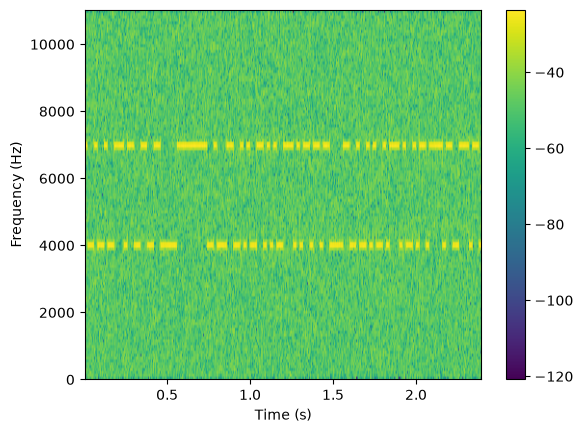
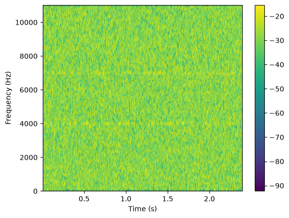

# Frequency Shift Keying (FSK) Communication System

A Python simulation of an end-to-end digital communication system, developed across four Signals and Systems project notebooks. The system encodes text as bits, modulates bits with two carrier frequencies, adds simulated channel noise, and reconstructs the message using matched filters and a binary detector.

## System overview

`Text → UTF-8 bits → FSK modulator → AWGN channel → Matched filters → Detector → Recovered bits → Text`

- **Text encoding:** Converts Unicode text to UTF-8 bytes and least-significant-bit-first bit sequences.
- **FSK transmitter:** Maps binary `0` and `1` to cosine tones at frequencies `f0` and `f1`.
- **Receiver:** Creates time-reversed reference tones, convolves the received waveform with both matched filters, samples once per bit period, and selects the stronger filter response.
- **Channel simulation:** Adds Gaussian noise at a selectable signal-to-noise ratio (SNR).
- **Evaluation:** Compares transmitted and recovered bits and plots time-domain signals and spectrograms.

## Repository structure

```text
fsk.py                 Reusable project functions extracted from the notebooks
demo.py                Standalone example: transmit and recover a text string
notebooks/
  01_bit_encoding.ipynb
  02_fsk_transmitter.ipynb
  03_matched_filters.ipynb
  04_complete_system.ipynb
figures/
  received_spectrogram_30dB.png
  received_spectrogram_10dB.png
requirements.txt
```

## Run the demo

```bash
python -m pip install -r requirements.txt
python demo.py
```

To explore the guided experiments, open the notebooks in order from Part 1 to Part 4. Run them from the repository root so the imports from `fsk.py` resolve. Jupyter Notebook or JupyterLab can be used.

## Selected results

In a four-bit simulation (`1001`), one recorded set of trials found:

| SNR (dB) | Bit errors (out of 4) |
| ---: | ---: |
| 100 | 0 |
| 20 | 0 |
| 10 | 1 |
| 0 | 2 |

A longer UTF-8 text transmission with 4 kHz and 7 kHz tones was decoded correctly at 30 dB, while a recorded 10 dB trial produced corrupted characters. In additional trials, recovery worked repeatedly near 11 dB, with errors appearing at 10 dB. **This is an approximate observed transition, not a hard SNR threshold:** individual results vary with random noise, and the small samples are not sufficient to estimate a precise error probability.

**Received signal at 30 dB SNR**



**Received signal at 10 dB SNR**



## Tools and concepts

Python, NumPy, Matplotlib, Jupyter notebooks; bitwise operations, signal generation, convolution, matched filtering, digital modulation, SNR, additive noise, and spectrogram analysis.

## Notes

This is a simulation and analysis project, not a physical radio transmitter. Noise is randomized, so repeated runs may produce different bit-error counts.